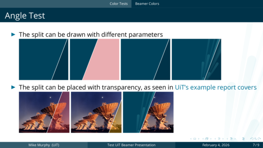

UiT Styles and Beamer Template for LaTeX
==================================================

This is an attempt to create LaTeX styles and templates for
UiT The Arctic University of Norway,
especially presentations with the [beamer package].

It follows the guidelines specified (in Norwegian) on
UiT's Grafisk profil (Graphic Profile) page,
specifically the graphic profile introduced in 2019.

<https://uit.no/ansatte/kommunikasjonstips/grafisk>


Sample PDFs:

* Presentation: [uitbeamertest.pdf](examples/uitbeamertest.pdf)
* Presentation with optional shading:
    [uitbeamertest-shadeblocks.pdf](examples/uitbeamertest-shadeblocks.pdf)
* Presentation with CMYK for glossy paper:
    [uitbeamertest-coatedpaper.pdf](examples/uitbeamertest-coatedpaper.pdf)
* Article:      [uitbeamerarticletest.pdf](examples/uitbeamerarticletest.pdf)

These packages are in an early stage, and were created by someone
who is neither a graphic designer, nor an expert in LaTeX programming
(though he is improving).

There is little in the way of documentation so far,
but I have tried to comment the code extensively
(without yet going so far as to learn [DocTeX]).
So see the different `.sty` files themselves,
and see `uitbeamertest.tex` for an example of how to use them.

[beamer package]: https://www.ctan.org/pkg/beamer
[DocTeX]: https://www.ctan.org/pkg/doc

Quick Start: Beamer Presentation
--------------------------------------------------

First, run `make` in this repository.
This will download the UiT logos and other assets used by the template,
and it will build the example presentation `uitbeamertest.tex`.

The build process requires the `convert` utility from ImageMagick.
On apt-based systems (Debian, Ubuntu, etc.) you can install ImageMagick with:

```bash
$ sudo apt install imagemagick
```

Then add this repository to your `TEXINPUTS` environment variable
(the extra ':' at the end causes TeX to append the normal search paths,
see `man pdflatex` for details on setting input directories):

```bash
$ export TEXINPUTS=.:..:$HOME/path/to/uit-latex:
```

To create a UiT beamer presentation, use the UiT color theme, the UiT inner
theme UiT, and the OpenSans font:

```latex
% In your beamer document preamble
\usepackage[default]{opensans}  % OpenSans is UiT's recommended font
\usecolortheme{uit}             % UiT colors
\useinnertheme{uit}             % UiT title page

% Optional: These should work nicely with the standard infolines outer theme
\useoutertheme{infolines}
```

Beamer Color Theme
----------------------------------------------------------------------

By default the color theme colors the text of headers on a white background,
similar to beamer's default.
To get shaded backgrounds for headers and blocks, similar to beamer's
`orchid` color scheme, pass the `shadeblocks` option to the color theme.


```latex
% Use shaded backgrounds for blocks and titles
\usecolortheme[shadeblocks]{uit}
```

Beamer Inner Theme / Title Page
----------------------------------------------------------------------

The UiT inner theme mostly changes the title page.
It should magically make your title page look very similar to the UiT
PowerPoint template's title page, with split blue background, starburst
decorative element (profilelement), and UiT logo.
(Don't forget to run `make` first to download the logo.)


### Adjusting Angle Element Position

Different aspects of the angled split in the title page (skråelement)
can be controlled through PGF/TikZ keys.
The most important key is `split pos`, which controls the horizontal
position of the split as a proportion of the width of the page.
The default is `0.66`: the split will shoot up and to the right starting
at a point 2/3rds of the way along the bottom edge of the page.

```latex
% Set the position of the angled split (skråelement),
% measured along bottom edge from left to right.
%   0.00 = Split comes up from bottom left corner
%   0.50 = Split comes up from center of bottom edge
%   0.66 = Split comes up from 2/3rds of the way across (DEFAULT)
%   1.00 = Split comes up from bottom right and runs off the page
\tikzset{split pos=.50}
```

See `uitbeamertest.tex` for examples,
and see the code in the "Angle Test" and "Rays Test" frames
for examples of using TikZ keys to change colors or add transparency.

### Add a Photo to the Title Page

UiT designs often place a photo under half of the split,
especially the right half.
The UiT inner theme uses beamer's `\titlegraphic` feature for this.
If you set a title graphic with `\titlegraphic`, the theme will place it in a
TikZ node anchored it to the right side of the page (`current page.east`),
and it will skip drawing the background and starburst pattern on the right side.

Typically this will be an `\includegraphics` command with `height=\paperheight`
and optional trimming.


```latex
% Title frame with graphic
\begin{frame}[plain]
    % Set title graphic
    \titlegraphic{\includegraphics
            [height=\paperheight, trim=0 0 1cm 0]
            {example-art/csiro-five-antennas-bg.jpg}}
            % (The trim key's arguments are left bottom right top)

    % Adjust split position
    \tikzset{split pos = .50}

    % Render title
    \titlepage
\end{frame}
```

Antenna photo by John Masterson, [CSIRO],
licensed under [CC-BY-3.0],
used unmodified except for cropping.
More info at [the photo's Wikimedia Commons page].

[CSIRO]: https://www.scienceimage.csiro.au/pages/about/
[CC-BY-3.0]: https://creativecommons.org/licenses/by/3.0/
[the photo's Wikimedia Commons page]: https://commons.wikimedia.org/wiki/File:CSIRO_ScienceImage_3881_Five_Antennas_at_Narrabri.jpg

Note that `\includegraphics` does not enlarge images, so if your photo is too
low a resolution, it might not stretch to the top and bottom of the page,
leaving you with awkward whitespace
(see the [graphicx package] for details on `\includegraphics`).

[graphicx package]: https://www.ctan.org/pkg/graphicx

### Add Decorative Rays to Background in Normal Slides

It is possible to add decorative rays to normal slides.
However, this option is disabled by default because it adds noticeable size and
rendering time to the PDFs. To enable it, pass the `bgelement` option to the
inner theme.



```latex
% Enable decorative element on background of normal frames
\useinnertheme[bgelement]{uit}
```

Files in this Repository
--------------------------------------------------

- **`Makefile`**
    --- Downloads UiT logos and other assets, and builds the test presentation.

    Be sure to run `make` before using the template.

- **`uit.sty`**
    --- A package providing UiT colors and styling commands
        in a template-agnostic way.

    My goal here is to provide fine-grained commands that can be used a la
    carte instead of bundling everything as an all-or-nothing `.cls` file.

    So far it defines UiT colors, as well as commands for drawing the split
    background.

- **`beamercolorthemeuit.sty`**
    --- A beamer color theme that uses the UiT colors defined in `uit.sty`

- **`beamerinnerthemeuit.sty`**
    --- Provides the UiT-themed title page.

    Note that the commands for actually drawing the background, split angle,
    and rays are all defined in `uit.sty`.

- **`uitbeamertest.tex`**
    --- An example UiT beamer presentation
        and a showcase / example for the various UiT style colors and commands

- **`uitbeamerarticletest.tex`**
    --- An example UiT beamer presentation rendered in article mode
        with `beamerarticle`

- **`uitbeamercontent.tex`**
    --- Content shared between presentation and article

- - - - -

UiT Styles and Beamer Template for LaTeX  
Copyright 2022 Michael J. Murphy  
See [LICENSE] file for licensing information  

[LICENSE]: LICENSE
